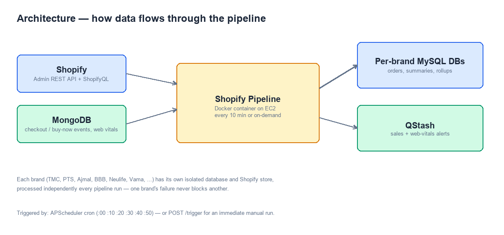
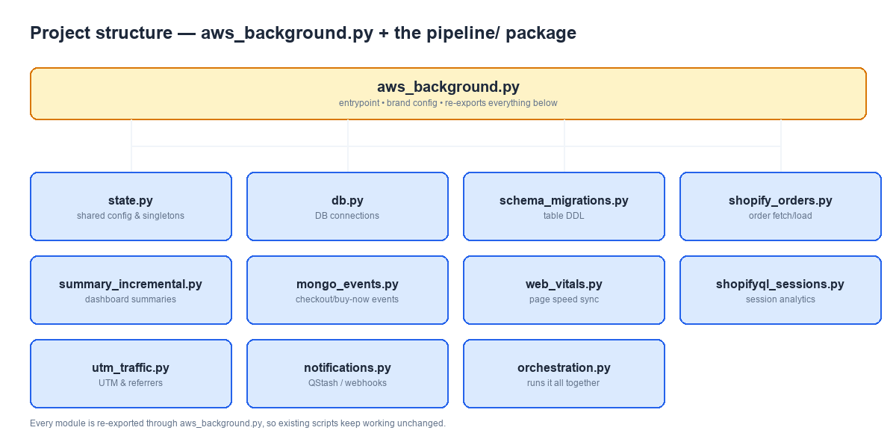

<!-- title: Shopify Pipeline -->

# Shopify Pipeline

A multi-brand Shopify data pipeline. It pulls orders, sessions, checkout events, and page-speed data for every configured brand, keeps each brand's own MySQL database up to date, and sends live alerts for sales and site performance.



## What it does

For every brand it manages, the pipeline:

- Fetches new and updated Shopify orders and loads them into that brand's own MySQL database.
- Pulls session and traffic data via ShopifyQL (Shopify's analytics query language).
- Syncs checkout-initiated and buy-now events from MongoDB.
- Syncs page-speed ("web vitals") data from MongoDB.
- Rebuilds dashboard summary tables — but only for the dates that actually changed, not the whole table — including a full payment-mode breakdown (COD, prepaid, partially-prepaid) for both order counts and sales amounts.
- Tracks any checkout/session event type per product variant, not just checkout-initiated and buy-now — new event types are discovered automatically and get their own column, via a separate daily worker.
- Rolls up "bundle" product sales (currently TMC and PTS) — bundle products are discovered automatically from the Shopify product catalog (active products only), not a hardcoded list.
- Sends live alerts to QStash: sales/session numbers and page-speed averages, per brand.
- Triggers the downstream cache pipeline directly after each run finishes, so dashboards pick up fresh data.

Each brand is fully isolated — its own database, its own Shopify store, its own failure boundary. If one brand's run fails, the others still complete.

## How it runs

- **Automatically**, every 10 minutes, via an internal scheduler (APScheduler).
- **On demand**, via `POST /trigger` (used for manual runs or by an external pipeline manager).
- Packaged as a Docker container, deployed on an EC2 instance.

## Project structure

The pipeline used to be a single ~10,000-line file. It's now split into focused modules under `pipeline/`, all tied together through `aws_background.py`, which remains the entrypoint.



| Module | Responsibility |
|---|---|
| `aws_background.py` | Entrypoint, brand configuration, and the facade that re-exports everything below (so nothing else in the repo had to change) |
| `pipeline/state.py` | Shared config and long-lived objects (logger, Flask app, scheduler, brand registries) |
| `pipeline/db.py` | Database connections, retries, and cleanup |
| `pipeline/schema_migrations.py` | Table creation / schema upkeep |
| `pipeline/shopify_orders.py` | Order fetching, transforming, and loading |
| `pipeline/summary_incremental.py` | Rebuilding dashboard summary tables |
| `pipeline/mongo_events.py` | Checkout-initiated / buy-now event sync |
| `pipeline/web_vitals.py` | Page-speed data sync |
| `pipeline/shopifyql_sessions.py` | Session and city-level traffic analytics |
| `pipeline/utm_traffic.py` | UTM and referrer attribution |
| `pipeline/notifications.py` | QStash alerts and webhook triggers |
| `pipeline/orchestration.py` | Runs everything above, per brand, per pipeline tick |
| `bundle_rollups.py` | Bundle product discovery (via the Shopify Admin API, active products only) and sales rollups (TMC, PTS) |
| `workers/events_summary_worker.py` | A separate, smaller worker that rolls up daily event totals — runs as its own Docker container |
| `workers/variant_wise_events_worker.py` | A separate worker that rolls up any Mongo event type, per product variant, into each brand's own database — runs as its own Docker container |
| `workers/checkout_login_status_worker.py` | A separate worker that rolls up daily checkout counts by logged-in/non-logged-in status, per brand and per variant — runs as its own Docker container |
| `backfill scripts/` | Standalone scripts for re-running specific pieces of the pipeline over a historical date range |

## Configuration

Brands are configured through numbered environment variables — one full set per brand index:

```
BRAND_NAME_0=PTS
BRAND_TAG_0=pts
DB_HOST_0=...
DB_USER_0=...
DB_PASSWORD_0=...
SHOP_NAME_0=...
ACCESS_TOKEN_0=...
```

In production, brand configuration is instead pulled from an internal brand-config API. Local/dev runs use `TEST_MODE=true`, which loads brand config from `.env.local` instead and disables outbound QStash calls.

Other important flags:

| Variable | Purpose |
|---|---|
| `SELF_RUN` | `true` = auto-run on schedule (every 10 minutes, or per `BRANDS_CRON_MAP` below); `false` = manual trigger only |
| `BRANDS_CRON_MAP` | Optional per-brand cron override, JSON `{"<brand_index>": "<minute-list>"}`, e.g. `{"3":"15,45","4":"15,45","1":"0,30","2":"0,30"}` runs brands 3/4 at :15/:45 past the hour and 1/2 at :00/:30. Any active brand **not** a key here (including every brand, if this is unset/empty) keeps running on the legacy every-10-min schedule - opt-in per brand. Read once at startup; changing it needs a restart. |
| `BACKFILL_MODE` | `true` = process a specific historical date window instead of "since last run" |
| `BACKFILL_BRAND_INDICES` | Restrict a backfill run to specific brands |
| `ALERTS_WEBHOOK_URL` | Where QStash-forwarded sales/web-vitals alerts get delivered |
| `UNMAPPED_PAYMENT_BRANDS` | Comma-separated brand names/tags that use the **unmapped** payment rule (default `editeveryday`): an order with no gateway name at all is reported in `unmapped_orders`/`unmapped_sales`, not as COD. **Every other brand keeps the original rule: a blank gateway name counts as COD** (so brands whose COD orders reach Shopify without a gateway name, such as BBB, still report COD). Names are compared ignoring case and punctuation; set it to an empty string to turn the unmapped rule off everywhere. Defined once in `pipeline/payment_mode.py`; applies to `order_summary`, `hour_wise_sales`, `overall_summary`, the city-wise tables and the discount dashboard's `payment_mode` |
| `PIPELINE_METRICS_SHEET_SWITCH` | `true` (default) = log each run's per-brand metrics to Google Sheets (see below); `false` disables it entirely |
| `PIPELINE_METRICS_SHEET_ID` | The destination spreadsheet's ID (the long id in its URL) |
| `GOOGLE_SHEETS_SERVICE_ACCOUNT_FILE` | Path to a service-account JSON key file, mounted into the container. Use this **or** the next var, not both |
| `GOOGLE_SHEETS_SERVICE_ACCOUNT_JSON_B64` | The same service-account JSON key, base64-encoded, as an env var instead of a mounted file |

### Backfill windows (`BACKFILL_MODE`)

With `BACKFILL_MODE=true` the pipeline replaces `shopify_orders` / `shopify_orders_update` for the window `BACKFILL_START_IST` .. `BACKFILL_END_IST` (both **inclusive**, interpreted in each brand's store timezone):

- Shopify is asked for orders whose `created_at` (new orders) / `updated_at` (updated orders) lies in that **exact time range**, and the same range - and only that range - is deleted before the re-fetched rows are inserted. Rows outside the range, even on the same date, are never touched.
- The delete and the insert are **one transaction**: if the insert fails the window is left as it was, and the backfill aborts for that brand.
- The Shopify fetch is **strict** in backfill mode: an HTTP error or exception mid-pagination aborts the brand's run instead of replacing the window with a partial list. (Normal 10-minute ticks keep the old tolerant behaviour.)
- Nothing is deleted if the fetch returns no orders.
- **A date without a time means midnight.** `BACKFILL_END_IST=2026-11-12` means `2026-11-12 00:00:00`, so orders *on* Nov 12 are not in the window (a startup warning says so). To include a whole day use `2026-11-12T23:59:59`. To backfill whole days use `START=<first day>` (or `T00:00:00`) and `END=<last day>T23:59:59`.
- While the container stays in backfill mode every 10-minute tick repeats the same window; set `BACKFILL_MODE=false` again when the backfill is done.

No secrets or real credentials are ever meant to live in source control — see `.env.local`/`.env` locally, and the deployment's own secret store in production.

### Pipeline run metrics (Google Sheets)

After each run, `pipeline/metrics_logging.py` appends one row per brand (new/updated order counts, affected-date count, sessions/ATC sessions synced, success/error, that brand's own duration) plus one `ALL BRANDS` summary row (aggregated counts, overall run duration), to a monthly worksheet (`Runs-2026-09`, etc., created automatically) in the spreadsheet at `PIPELINE_METRICS_SHEET_ID`. It's entirely best-effort — a Sheets outage, bad credentials, or quota error is logged and never fails or delays the pipeline run.

One-time setup:
1. In Google Cloud Console, create a service account and download its JSON key.
2. Enable the Google Sheets API for that project.
3. Share your destination spreadsheet with the service account's email (found in the JSON key, `client_email`) as **Editor**.
4. Set `PIPELINE_METRICS_SHEET_ID` (from the spreadsheet's URL) and either `GOOGLE_SHEETS_SERVICE_ACCOUNT_FILE` or `GOOGLE_SHEETS_SERVICE_ACCOUNT_JSON_B64`.

## Running it locally

```bash
pip install -r requirements.txt
python aws_background.py
```

With `TEST_MODE=true`, this loads brand config from `.env.local`, starts the scheduler, and serves the API on port 5000.

Check it's alive:

```bash
curl http://localhost:5000/health
```

Trigger a run manually:

```bash
curl -X POST http://localhost:5000/trigger \
  -H "Content-Type: application/json" \
  -H "x-pipeline-key: <PIPELINE_AUTH_HEADER>" \
  -d '{"runId": "manual-test-1"}'
```

## API endpoints

| Endpoint | Method | Purpose |
|---|---|---|
| `/health` | GET | Basic liveness check, returns `{"status": "healthy", ...}` |
| `/trigger` | POST | Runs the pipeline immediately. Requires an `x-pipeline-key` header and a JSON body with a `runId`. Optional `brandIds` (a list, or a single `brandId`) restricts the run to just those brands, independent of `BRANDS_CRON_MAP` grouping - omitted, it runs every active brand as before |

## Deployment

Runs as four Docker services (see `docker-compose.yml`):

- **`shopify-pipeline`** — the main pipeline described above.
- **`events-summary-worker`** — a separate container running two independent schedules. The master `events_summary` table (daily event totals across all brands) keeps its original once-daily schedule. On top of that, every 15 minutes it incrementally ingests raw `alerts.sessions` events (watermark-based, per brand) into each CI-events-enabled brand's own `raw_mongo_events` table (every document key becomes a column, nested `data` is flattened, new keys add columns automatically, `createdAt`/`updatedAt` kept as UTC and IST), deletes the now-ingested documents from Mongo so the cluster doesn't fill up on storage, and rolls the newly-ingested dates up into `hourly_sessions_summary_shopify`/`daily_ci_events_summary`/`daily_buy_now_events_summary`/`overall_summary`. Every dynamic column is text, so a value is never turned into NULL for not fitting a type; a value that can't get its own column (column cap, MySQL row-size limit, colliding key names) is kept as JSON in that row's `extra_data` column, so nothing is lost before the Mongo document is deleted. The table is created per brand on first use, with only the indexes the rollups need (`event_type, created_at_utc` and `created_at_utc`); tables created earlier get the same layout by applying `migrations/008_raw_mongo_events_indexes.sql` by hand, off-peak, one brand at a time. Each cycle the rollups read the checkout_initiated / buy_now rows of the affected window once (a cycle-scoped cache in `pipeline/mongo_events_sql.py`, capped by `MONGO_EVENTS_ROW_CACHE_MAX_ROWS`, default 300000, falling back to per-rollup queries above it) instead of once per rollup, and they only run when the ingested batch contained one of those two event types. Copying the legacy `mongo_events_summary` history into `raw_mongo_events` is OFF by default (`MONGO_EVENTS_LEGACY_COPY=true` starts it; it resumes where it stopped and is throttled by `MONGO_EVENTS_LEGACY_COPY_MAX_SECONDS`) because the summary tables already hold every past day and the copy is a heavy sustained write load; the legacy table is left untouched, so old dates can still be recomputed from it. Older history can be loaded with `backfill scripts/backfill_mongo_events_summary.py`.
- **`variant-wise-events-worker`** — a separate container that rolls up any event type (read from `raw_mongo_events`, not Mongo directly), per product variant, into each brand's own database, every 30 minutes.
- **`checkout-login-status-worker`** — a separate container that rolls up daily checkout counts by logged-in/non-logged-in status, per brand, every 6 hours (00:00/06:00/12:00/18:00 IST).
- **`pnl-worker`** — a separate container that builds the daily brand-level P&L (`overall_pnl`) in each brand DB at 00:10 IST, from the summary tables plus the brand's cost config in the arch-auth Mongo `total_config` collection. Right before that it syncs paid-ads spend for exactly the dates it is rebuilding: for every brand with a credential document in Mongo (`meta_ads_credentials` / `google_ads_credentials`, pasted on the dashboard's P&L page) it pulls that channel's daily spend and upserts it into `pnl_meta_ad_spend_rollup` / `pnl_google_ad_spend_rollup` (`migrations/004_pnl_ad_spend_rollups.sql`, per brand DB). Brands without a document for a channel are skipped for it. Needs `PASSWORD_AES_KEY` (same as the dashboard, to decrypt tokens) and, for Google only, `GOOGLE_ADS_CLIENT_ID`, `GOOGLE_ADS_CLIENT_SECRET` and `GOOGLE_ADS_DEVELOPER_TOKEN`; `META_API_VERSION` / `GOOGLE_ADS_API_VERSION` are optional. A failed pull is logged, written to the document's `last_error`, and that line falls back to the configured cost.

The behavioral/click/session intent-events worker that used to run here now runs as its own service outside this repo; its retired code is kept under [`dead_code/`](dead_code/README.md).

To deploy an update on the server: pull the latest code on the branch that's live, rebuild, and restart:

```bash
cd ~/pipelines/aws-pipeline-ec2
git pull origin master
docker compose build shopify-pipeline events-summary-worker variant-wise-events-worker checkout-login-status-worker
docker compose up -d shopify-pipeline events-summary-worker variant-wise-events-worker checkout-login-status-worker
```

`checkout-login-status-worker`'s own schedule is every 6 hours, so after deploying a change to it, optionally trigger one immediate run instead of waiting for the next scheduled tick:

```bash
docker compose exec -T checkout-login-status-worker \
  python -c "from workers.checkout_login_status_worker import run_worker; run_worker()"
```

### Cache pipeline trigger

The cache pipeline runs as its own container (`cache-pipeline`) on the same EC2 host, joined to the same Docker network (`pipeline-net`) as `shopify-pipeline`. After each full run finishes, the pipeline fires a plain `GET http://cache-pipeline:8080/trigger-pipeline` — no QStash involved, just a direct container-to-container call over the shared network.

This request runs in a background thread, so the pipeline doesn't wait for the cache rebuild to finish before moving on. Whenever the response does come back, only a short summary (status + brand count) is logged — not the full per-brand/per-date result body.

### Per-brand cron groups

With `BRANDS_CRON_MAP` set, each distinct cron value gets its own scheduler job (independent `max_instances=1`, so a slow run of one group never blocks another group's tick), plus the always-registered legacy fallback job (`pipeline_job`, every 10 minutes) for anything not in the map. A manual `/trigger` call — with or without `brandIds` — always runs as its own one-off job, so it can overlap with a brand's own cron group if the timing lines up; per-brand DB writes are upserts (`ON DUPLICATE KEY UPDATE`), so the worst case is duplicated work, not corrupted data.

## Triggering a worker manually

Every standalone worker (`pnl`, `events-summary`, `variant-wise-events`, `checkout-login-status`, `data-purge`) can be run on demand, once, without waiting for its own schedule. Both knobs below use the same registry in `workers/registry.py`, so adding a worker there makes it available to both.

### From a shell

```bash
python -m workers.run list                                      # what's available
python -m workers.run pnl                                       # default window
python -m workers.run pnl --start 2026-09-01 --end 2026-09-15   # backfill a range
python -m workers.run checkout-login-status --as-of 2026-09-10T00:05:00+05:30
python -m workers.run pnl --env-file env                        # load a specific dotenv file
```

It loads `.env` (or a file named `env`) unless `--env-file` says otherwise, forces the worker's `*_SELF_RUN` flag off, runs it in the foreground, and exits 0/1. Inside Docker:

```bash
docker compose exec -T shopify-pipeline python -m workers.run pnl
```

### Over HTTP (main pipeline container, port 5000)

```bash
curl http://localhost:5000/workers                                       # list + last run per worker
curl -X POST http://localhost:5000/workers/pnl/trigger \
  -H "x-pipeline-key: $PIPELINE_AUTH_HEADER" \
  -H "Content-Type: application/json" \
  -d '{"start": "2026-09-01", "end": "2026-09-15"}'                      # body optional
curl http://localhost:5000/workers/pnl/status                            # running / succeeded / failed
```

The trigger spawns `python -m workers.run <name>` as a child process of the pipeline container, so the worker's output shows up in `docker logs shopify-pipeline`. One run per worker at a time; a second trigger while one is running returns 409.

## Data purge worker

A monthly worker (`workers/data_purge_worker.py`, logic in `pipeline/data_purge.py`) that keeps the live databases from growing without bound: it **archives** rows older than the retention cutoff to S3 as CSV, **verifies** the archive, and only then (and only when explicitly allowed) **deletes** them in batches. The archive is the historical backup. **Deploying it does nothing destructive** - it ships disabled.

### Retention rule and cutoff

Keep the most recent 6 calendar months. `cutoff = first day of the run's month (IST) - 6 calendar months` (calendar-month arithmetic, never "180 days"); a row is eligible when `date_column < cutoff`, strictly.

```text
Run:     2026-10-01
Cutoff:  2026-04-01
Archive: s3://<bucket>/<prefix>/2026-10/<brand>/<table>.csv
Purged:  all rows where the table's date column < 2026-04-01   (March 2026 and earlier)
Kept:    2026-04-01 and later
```

2026-11-01 -> 2026-05-01; 2026-01-01 -> 2025-07-01. Any day of the month gives the same cutoff, so a late or repeated run is identical. `raw_mongo_events` is purged by `created_at_ist` (a naive DATETIME that already holds IST wall-clock time), so its cutoff is simply `2026-04-01 00:00:00`. For columns stored in UTC (the legacy `mongo_events_summary`) the cutoff instant is 00:00 of the cutoff date **in the brand's timezone** converted to UTC (IST: `2026-03-31 18:30:00`).

### Tables and date columns

Every table is processed per brand database. The date column is explicit configuration (`PURGE_TABLES` in `pipeline/data_purge.py`), and **every table is re-validated against the live schema before anything happens** (it must be a base table, the date column must exist with an accepted type, a date index must exist and the export/delete plans must use it via `EXPLAIN`); otherwise the table is skipped with a reason.

| Table | Date column | Type / timezone | Notes |
|---|---|---|---|
| `shopify_orders_update` | `updated_date` | `YYYY-MM-DD`, brand timezone | no PK in code; append-only; live code only reads `max(updated_at)` |
| `mongo_events_summary` | `created_at_utc` | UTC datetime | legacy table, no DDL in repo -> **schema not confirmed**: skipped until confirmed |
| `shopify_orders` | `created_date` | `YYYY-MM-DD`, brand timezone | no PK in code; see the warning below |
| `raw_mongo_events` | `created_at_ist` | IST wall-clock datetime | PK `event_id`; **needs an index leading with `created_at_ist` (`migrations/009`) - skipped until it exists**; the archive is the only backup of these events |
| `product_sessions_snapshot` | `date` | date | no DDL/writer in repo -> **schema not confirmed**: skipped until confirmed |
| `mv_product_sessions_by_path_daily`, `mv_product_sessions_by_type_daily` | `date` | date | derived daily aggregates; not defined anywhere in this repo - the `date` column was confirmed on the live tables. If one is really a view, or has no index leading with `date`, the live checks skip it (`SKIPPED_VIEW` / `SKIPPED_NO_INDEX`). They can hold more than 6 months of history, so check that no dashboard or refresh job depends on the older rows before allowing deletion |

A table with **no** configured date column is never touched (`SKIPPED_AMBIGUOUS`). "Not confirmed" tables are validated and described in the dry run only; archive/delete stay skipped until their live schema (`SHOW CREATE TABLE`) is confirmed and `schema_confirmed` is flipped in `PURGE_TABLES`. Tables with a real, NOT NULL primary key are exported by keyset paging; tables without a unique key (e.g. `shopify_orders`) are exported one calendar-day window at a time (never pretending to be keyset).

### S3 archive structure

Deterministic keys, one isolated prefix per purge month, one folder per brand (every brand database has the same table names):

```text
<prefix>/2026-10/<brand>/shopify_orders.csv
<prefix>/2026-10/<brand>/shopify_orders.manifest.json        <- written last; the only proof of a complete archive
<prefix>/2026-10/<brand>/shopify_orders.purge-complete.json  <- written after the delete finished (reporting only)
...
```

The CSV has a header and **every column** of the table (read from `information_schema`, not hand-listed), UTF-8, streamed straight to S3 (multipart, no temp file, bounded memory). **NULL is written as `\N`**; an empty string stays empty; a literal string that starts with a backslash gets one extra backslash, so a field that is exactly `\N` is always NULL. The manifest records table, brand, month, cutoff, date column, row count, byte size, sha256, min/max date, column list and key. The sha256 is also stored as an S3 object tag. Encryption: the bucket's default encryption is used (optional `DATA_PURGE_S3_SSE` / `DATA_PURGE_S3_KMS_KEY_ID`); credentials come only from the default AWS chain (instance role) - none are in code.

### Configuration

| Variable | Default | Meaning |
|---|---|---|
| `DATA_PURGE_ENABLED` | `false` | `false` -> the worker does nothing destructive |
| `DATA_PURGE_DRY_RUN` | `false` | `true` -> **read-only** report; takes precedence over everything; runs even when disabled; no S3 writes, no deletes |
| `DATA_PURGE_ARCHIVE_ONLY` | `true` | destructive only when **explicitly** `false` |
| `PURGE_TEST` | `false` | `true` = **export to S3 but never delete**: a hard override that caps any enabled run at archive-only, whatever `ARCHIVE_ONLY` / `DATA_PURGE_DELETE_TABLES` say. It does not enable a disabled worker (`DATA_PURGE_ENABLED=true` and a bucket are still needed) and does not change dry-run |
| `DATA_PURGE_DELETE_TABLES` | empty | comma list of tables allowed to be deleted (must be a subset of `DATA_PURGE_TABLES`); required when `ARCHIVE_ONLY=false` |
| `DATA_PURGE_TABLES` | all seven | tables to archive |
| `DATA_PURGE_S3_BUCKET` | - | required for archive/delete runs |
| `DATA_PURGE_S3_PREFIX` | `data-purge` | archive root |
| `DATA_PURGE_BATCH_SIZE` | `1000` | rows per delete batch (**conservative, untuned** - tune from the per-batch logs) |
| `DATA_PURGE_EXPORT_BATCH_SIZE` | `2000` | rows per export read |
| `DATA_PURGE_SLEEP_BETWEEN_BATCHES_S` | `1.0` | pause after each delete batch (throttle for EBS/replicas) |
| `DATA_PURGE_MAX_WINDOW_ROWS` | `200000` | per-day window cap for tables without a unique key (over -> the table fails, nothing deleted) |
| `DATA_PURGE_S3_SSE`, `DATA_PURGE_S3_KMS_KEY_ID` | unset | optional explicit encryption |
| `DATA_PURGE_WORKER_SELF_RUN` | `true` | `false` = run once and exit |
| `DATA_PURGE_WORKER_MEM_LIMIT`, `DATA_PURGE_WORKER_CPUS`, `DATA_PURGE_DB_READ_TIMEOUT_S` | `512m`, `0.5`, `600` | compose overrides (the longer read timeout is for COUNT/EXPLAIN on large tables) |

| ENABLED | DRY_RUN | ARCHIVE_ONLY | Mode |
|---|---|---|---|
| any | true | any | **DRY_RUN** (read-only) |
| false | false | any | **DISABLED** |
| true | false | true (default) | **ARCHIVE_ONLY**: archive + verify + manifest, never delete |
| true | false | false | **FULL**: archive, verify, then delete - only tables in `DATA_PURGE_DELETE_TABLES` |

`PURGE_TEST=true` is the safe way to test the export end to end (it also triggers one run right after each container restart/rebuild, so just redeploy to test): the CSV and manifest are written and verified, no `DELETE` is ever issued, and the summary says so. Archive keys are deterministic per month, so a second test run in the same month reuses the verified archive instead of exporting again - to re-test an export, remove that month's objects from S3 or run with a different `--as-of` month. Turning `PURGE_TEST` off later in the same month reuses the archive and (if mode and allowlist permit) deletes.

Booleans accept only `true`/`false`; anything else (or an invalid number, an unknown table, a missing bucket, `ARCHIVE_ONLY=false` without a delete allowlist) makes the worker **refuse to run**.

### Schedule

The 1st of every month at **03:23 IST** (`Asia/Kolkata`, like the other workers; the purge month is the IST month). `coalesce`, `max_instances=1`, a 24 h misfire grace so a container that was down at the trigger still runs once after it starts. Nothing runs at startup - **except with `PURGE_TEST=true`**, which runs one export-only pass immediately on every container (re)start/rebuild (before the scheduler starts; it can never delete, still needs `DATA_PURGE_ENABLED=true` and a bucket, and a failure is logged without stopping the container). The monthly schedule stays active either way.

### Dry run and manual execution

```bash
# read-only report: cutoff, eligible rows, detected date column/type/index/unique key, EXPLAIN verdict,
# whether the table is archiveable / deletion would be supported, table size (metadata only)
DATA_PURGE_DRY_RUN=true python -m workers.run data-purge
DATA_PURGE_DRY_RUN=true python -m workers.run data-purge --brand-id PTS --as-of 2026-10-01T03:23:00+05:30

# real run once (still obeys ENABLED / ARCHIVE_ONLY / DELETE_TABLES)
python -m workers.run data-purge [--brand-id PTS] [--as-of <ISO datetime>]

# inside Docker
docker compose exec -T data-purge-worker python -m workers.run data-purge
```

The dry run never scans a whole table: the exact eligible count runs under a 60 s `MAX_EXECUTION_TIME` hint and falls back to the `EXPLAIN` estimate (labelled "estimated") or "skipped (expensive)".

### Failure and retry behaviour

Per table, in order: validate config -> validate table/schema/index/`EXPLAIN` -> compute cutoff -> preflight guards -> count -> (dry run stops here) -> reuse a valid manifest or export + upload -> verify the S3 object (exists, size equals the bytes written) -> recount sanity check -> write the manifest -> only now: delete in committed batches -> verify nothing eligible remains.

- Export, upload, verification or manifest failure -> **nothing is deleted**; the table is `FAILED` and the next run retries.
- Crash after the upload but before the manifest -> the CSV is reused only if it is positively confirmed complete (completion tags, size, row count, cutoff and header all match); otherwise it is deterministically replaced. A CSV without a manifest is never trusted for deletion.
- A manifest that exists is authoritative and **never overwritten**; if it does not match this table/brand/month/cutoff/columns, the table fails for manual review.
- Crash or error mid-delete -> the archive stays; the next run finds the manifest, re-validates it and deletes the remainder. Deletes are capped at the archived row count, and refused if more rows are eligible than were archived.
- It refuses to delete when that would empty the table (ingestion watermarks need a row).
- Statuses: `SUCCESS`, `ARCHIVED_ONLY`, `FAILED`, `NO_DATA`, `DRY_RUN`, `SKIPPED_*` (with the reason). One table or brand failing never stops the others; the process exits non-zero if any table failed. Zero eligible rows -> no S3 objects, no `DELETE`.

### Safety guarantees and the operational invariant

Nothing is deleted before the archive is complete and verified; batches are small and committed individually (no giant `DELETE`/transaction); rows are never loaded into memory wholesale; `date >= cutoff` can never match; logs contain counts, never row data.

**Invariant: rows with `date < cutoff` must be treated as immutable while a purge runs.** The row-count recount is a sanity check only - it does not prove the exact same rows were exported. What can break the invariant (nothing in the repo locks against it): env-driven `BACKFILL_MODE` (re-inserts order windows) and manual `backfill scripts/` runs over old windows; `MONGO_EVENTS_LEGACY_COPY=true`; `backfill_mongo_events_summary.py`. Best-effort guards skip a table when a conflicting env flag is set in this container or another session is currently running a write against it (`SHOW FULL PROCESSLIST`); manual scripts are invisible. **Runbook rule: do not run backfills over windows older than the cutoff while the purge runs.**

### `shopify_orders`: not proven safe to delete

Old orders are not dead data. A cancel/RTO/refund of an old order puts its **old `created_date`** into the rebuild set (`returns_fact.order_created_date`, no age limit), and the summary rebuilds read `shopify_orders` for that date. If the rows are gone, those rebuilds can **overwrite with zeros** (`sales_summary` when refund events exist, `hour_wise_sales`, `daily/hourly_citywise_summary` when session rows exist, order columns of `shopify_orders_utm_daily`) or **delete** bundle rollup rows; `order_summary`, `discount_summary`, `gross_summary`, `rto_summary` and the `dashboard_discount_*` tables keep their old rows. Manual `backfill_citywise_summary.py` / `bundle_rollup_backfill.py` over purged dates are destructive too. The repo cannot establish that nothing needs this history, so the **first destructive rollout should exclude `shopify_orders`** (archive it, keep it in `DATA_PURGE_TABLES`, leave it out of `DATA_PURGE_DELETE_TABLES`). `shopify_orders_update` (only `max(updated_at)` is read) is the lowest-risk order table. `raw_mongo_events` is safe for live workers (they read recent windows) but its archive is the only backup once deleted.

### Production rollout

1. **Month 0:** deploy (idle). Run the read-only schema/index/`EXPLAIN` checks and `DATA_PURGE_DRY_RUN=true`; apply missing date-index migrations manually where the dry run reports `SKIPPED_NO_INDEX` (006/007 for the order tables, `009` for `raw_mongo_events.created_at_ist` - an online but I/O-heavy index build, off-peak, one brand at a time); confirm the schemas of the "not confirmed" tables.
2. **Month 1 (archive only):** set bucket/prefix + IAM, `DATA_PURGE_ENABLED=true` (leave `ARCHIVE_ONLY` at its default). Start with one brand and one small table; check S3 sizes/row counts/manifests and DB load/EBS; do a restore drill (load a sample CSV into a scratch table, mapping `\N` to NULL); widen to all brands/tables. Validate the `shopify_orders` dependencies above.
3. **Only after that:** `DATA_PURGE_ARCHIVE_ONLY=false` and `DATA_PURGE_DELETE_TABLES` listing only tables proven safe (suggested order: `shopify_orders_update`, `raw_mongo_events` once restore is proven, then the rest; `shopify_orders` last or never). Tune `DATA_PURGE_BATCH_SIZE` / `DATA_PURGE_SLEEP_BETWEEN_BATCHES_S` from the per-batch logs. New variables go in the Jenkins `.env` secret file.

IAM for the host role: `s3:PutObject`, `s3:GetObject` (HEAD/read), `s3:ListBucket` on the prefix, and `s3:PutObjectTagging` / `s3:GetObjectTagging` (tagging failures are non-fatal). With a Docker bridge network the instance-metadata hop limit may need to be 2 for the role to be reachable.

### Operational notes

Deleting InnoDB rows frees space **inside** the tablespaces; it does not shrink the RDS *allocated storage* metric, and the worker never runs `OPTIMIZE TABLE` (heavy I/O, temp space and locking - treat reclaiming space as a separate, planned operation). The point is to cap live row counts and future growth while keeping history recoverable in S3. Deletes are write-heavy: brands and tables are processed strictly one at a time, in small batches with a pause, at 03:23 IST.

## Testing

```bash
python -m unittest discover -p "test_*.py"
```

Covers brand-activation filtering, bundle rollup logic, UTM source mapping, and the events summary worker.

## Backfill scripts

`backfill scripts/` holds standalone tools for re-running one specific piece of the pipeline over a chosen date range — useful for fixing a gap in historical data without re-running everything.

| Category | Examples |
|---|---|
| Orders & addresses | `backfill_shopify.py`, `backfill_shopify_order_addresses.py`, `backfill_shopify_order_tags.py` |
| Returns / RTO | `backfill_returns_fact_order_created_date.py`, `backfill_rto_summary.py` |
| Checkout / buy-now events | `backfill_checkout_initiated_ci_events.py`, `backfill_buy_now_events.py`, and their variant-level counterparts |
| Variant-wise events | `backfill_variant_wise_events_summary.py` |
| Sessions & web vitals | `backfill_hourly_sessions.py`, `backfill_web_vitals_summary.py`, `backfill_daily_web_vitals_summary.py` |
| UTM & traffic | `utm_sessions_backfill.py`, `referrer_sessions_backfill.py`, `backfill_product_traffic_split.py` |
| Bundles | `bundle_rollup_backfill.py` |
| Payment mode breakdown | `backfill_payment_mode_breakdown_columns.py` — cod/prepaid/ppcod order counts and sales amounts only, on `hour_wise_sales` and `overall_summary` |

Each script is run directly with Python and reads the same brand configuration as the main pipeline.
