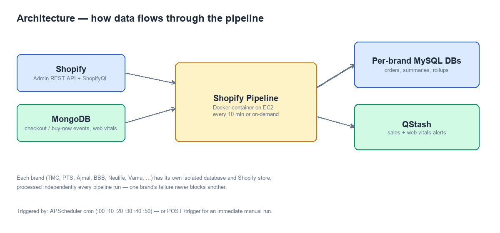
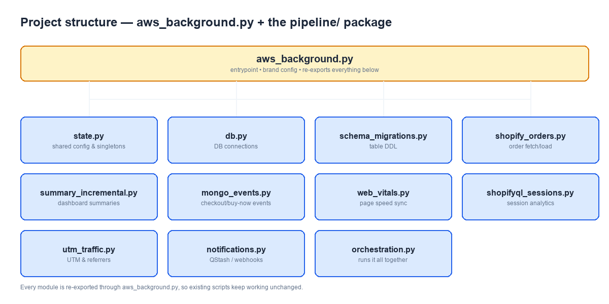

<!-- title: Shopify Pipeline -->

# Shopify Pipeline

A multi-brand Shopify data pipeline. It pulls orders, sessions, checkout events, and page-speed data for every configured brand, keeps each brand's own MySQL database up to date, and sends live alerts for sales and site performance.



## What it does

For every brand it manages, the pipeline:

- Fetches new and updated Shopify orders and loads them into that brand's own MySQL database.
- Pulls session and traffic data via ShopifyQL (Shopify's analytics query language).
- Syncs checkout-initiated and buy-now events from MongoDB.
- Syncs page-speed ("web vitals") data from MongoDB.
- Rebuilds dashboard summary tables — but only for the dates that actually changed, not the whole table — including a full payment-mode breakdown (COD, prepaid, partially-prepaid) for both order counts and sales amounts.
- Tracks any checkout/session event type per product variant, not just checkout-initiated and buy-now — new event types are discovered automatically and get their own column, via a separate daily worker.
- Rolls up "bundle" product sales (currently TMC and PTS) — bundle products are discovered automatically from the Shopify product catalog (active products only), not a hardcoded list.
- Sends live alerts to QStash: sales/session numbers and page-speed averages, per brand.
- Triggers the downstream cache pipeline directly after each run finishes, so dashboards pick up fresh data.

Each brand is fully isolated — its own database, its own Shopify store, its own failure boundary. If one brand's run fails, the others still complete.

## How it runs

- **Automatically**, every 10 minutes, via an internal scheduler (APScheduler).
- **On demand**, via `POST /trigger` (used for manual runs or by an external pipeline manager).
- Packaged as a Docker container, deployed on an EC2 instance.

## Project structure

The pipeline used to be a single ~10,000-line file. It's now split into focused modules under `pipeline/`, all tied together through `aws_background.py`, which remains the entrypoint.



| Module | Responsibility |
|---|---|
| `aws_background.py` | Entrypoint, brand configuration, and the facade that re-exports everything below (so nothing else in the repo had to change) |
| `pipeline/state.py` | Shared config and long-lived objects (logger, Flask app, scheduler, brand registries) |
| `pipeline/db.py` | Database connections, retries, and cleanup |
| `pipeline/schema_migrations.py` | Table creation / schema upkeep |
| `pipeline/shopify_orders.py` | Order fetching, transforming, and loading |
| `pipeline/summary_incremental.py` | Rebuilding dashboard summary tables |
| `pipeline/mongo_events.py` | Checkout-initiated / buy-now event sync |
| `pipeline/web_vitals.py` | Page-speed data sync |
| `pipeline/shopifyql_sessions.py` | Session and city-level traffic analytics |
| `pipeline/utm_traffic.py` | UTM and referrer attribution |
| `pipeline/notifications.py` | QStash alerts and webhook triggers |
| `pipeline/orchestration.py` | Runs everything above, per brand, per pipeline tick |
| `bundle_rollups.py` | Bundle product discovery (via the Shopify Admin API, active products only) and sales rollups (TMC, PTS) |
| `workers/events_summary_worker.py` | A separate, smaller worker that rolls up daily event totals — runs as its own Docker container |
| `workers/variant_wise_events_worker.py` | A separate worker that rolls up any Mongo event type, per product variant, into each brand's own database — runs as its own Docker container |
| `workers/checkout_login_status_worker.py` | A separate worker that rolls up daily checkout counts by logged-in/non-logged-in status, per brand and per variant — runs as its own Docker container |
| `backfill scripts/` | Standalone scripts for re-running specific pieces of the pipeline over a historical date range |

## Configuration

Brands are configured through numbered environment variables — one full set per brand index:

```
BRAND_NAME_0=PTS
BRAND_TAG_0=pts
DB_HOST_0=...
DB_USER_0=...
DB_PASSWORD_0=...
SHOP_NAME_0=...
ACCESS_TOKEN_0=...
```

In production, brand configuration is instead pulled from an internal brand-config API. Local/dev runs use `TEST_MODE=true`, which loads brand config from `.env.local` instead and disables outbound QStash calls.

Other important flags:

| Variable | Purpose |
|---|---|
| `SELF_RUN` | `true` = auto-run every 10 minutes; `false` = manual trigger only |
| `BACKFILL_MODE` | `true` = process a specific historical date window instead of "since last run" |
| `BACKFILL_BRAND_INDICES` | Restrict a backfill run to specific brands |
| `ALERTS_WEBHOOK_URL` | Where QStash-forwarded sales/web-vitals alerts get delivered |

No secrets or real credentials are ever meant to live in source control — see `.env.local`/`.env` locally, and the deployment's own secret store in production.

## Running it locally

```bash
pip install -r requirements.txt
python aws_background.py
```

With `TEST_MODE=true`, this loads brand config from `.env.local`, starts the scheduler, and serves the API on port 5000.

Check it's alive:

```bash
curl http://localhost:5000/health
```

Trigger a run manually:

```bash
curl -X POST http://localhost:5000/trigger \
  -H "Content-Type: application/json" \
  -H "x-pipeline-key: <PIPELINE_AUTH_HEADER>" \
  -d '{"runId": "manual-test-1"}'
```

## API endpoints

| Endpoint | Method | Purpose |
|---|---|---|
| `/health` | GET | Basic liveness check, returns `{"status": "healthy", ...}` |
| `/trigger` | POST | Runs the pipeline immediately. Requires an `x-pipeline-key` header and a JSON body with a `runId` |

## Deployment

Runs as four Docker services (see `docker-compose.yml`):

- **`shopify-pipeline`** — the main pipeline described above.
- **`events-summary-worker`** — a separate container that rolls up daily event totals across all brands into one summary table, on its own daily schedule.
- **`variant-wise-events-worker`** — a separate container that rolls up any Mongo event type, per product variant, into each brand's own database, on its own daily schedule.
- **`checkout-login-status-worker`** — a separate container that rolls up daily checkout counts by logged-in/non-logged-in status, per brand, on its own daily schedule (00:05 IST).

Deploys are automated via `.github/workflows/deploy.yml`: every push to `master` creates a workflow run that connects to the EC2 host over SSH from a GitHub-hosted runner (nothing to install on EC2 itself), pulls, rebuilds, and restarts all four services, then fires one immediate one-off run of `checkout-login-status-worker` (its own schedule is once a day, so a deploy doesn't otherwise take effect until the next scheduled tick) — but none of this ever runs on its own. It sits in "Waiting for review" until an authorized reviewer approves it from the Actions tab. See `docs/DEPLOYMENT.md` for the one-time setup (SSH deploy key + approval gate) and the manual fallback command sequence.

### Cache pipeline trigger

The cache pipeline runs as its own container (`cache-pipeline`) on the same EC2 host, joined to the same Docker network (`pipeline-net`) as `shopify-pipeline`. After each full run finishes, the pipeline fires a plain `GET http://cache-pipeline:8080/trigger-pipeline` — no QStash involved, just a direct container-to-container call over the shared network.

This request runs in a background thread, so the pipeline doesn't wait for the cache rebuild to finish before moving on. Whenever the response does come back, only a short summary (status + brand count) is logged — not the full per-brand/per-date result body.

## Testing

```bash
python -m unittest discover -p "test_*.py"
```

Covers brand-activation filtering, bundle rollup logic, UTM source mapping, and the events summary worker.

## Backfill scripts

`backfill scripts/` holds standalone tools for re-running one specific piece of the pipeline over a chosen date range — useful for fixing a gap in historical data without re-running everything.

| Category | Examples |
|---|---|
| Orders & addresses | `backfill_shopify.py`, `backfill_shopify_order_addresses.py`, `backfill_shopify_order_tags.py` |
| Returns / RTO | `backfill_returns_fact_order_created_date.py`, `backfill_rto_summary.py` |
| Checkout / buy-now events | `backfill_checkout_initiated_ci_events.py`, `backfill_buy_now_events.py`, and their variant-level counterparts |
| Variant-wise events | `backfill_variant_wise_events_summary.py` |
| Sessions & web vitals | `backfill_hourly_sessions.py`, `backfill_web_vitals_summary.py`, `backfill_daily_web_vitals_summary.py` |
| UTM & traffic | `utm_sessions_backfill.py`, `referrer_sessions_backfill.py`, `backfill_product_traffic_split.py` |
| Bundles | `bundle_rollup_backfill.py` |
| Payment mode breakdown | `backfill_payment_mode_breakdown_columns.py` — cod/prepaid/ppcod order counts and sales amounts only, on `hour_wise_sales` and `overall_summary` |

Each script is run directly with Python and reads the same brand configuration as the main pipeline.
